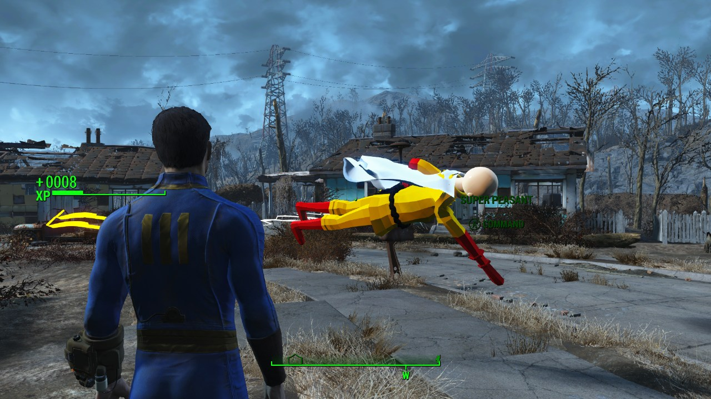

# Super Peasant — One Punch Man for Fallout 4

A flying, hard-hitting companion for the Commonwealth: call him with a whistle, send him after attackers, or bring him along for the chaos.

*Actual Fallout4 development gameplay.*

**[Download the public preview](https://github.com/0mis/fallout4-super-peasant/releases/latest)** · **[Watch/download trailer](https://github.com/0mis/fallout4-super-peasant/releases/download/v0.1.0-preview1/One-Punch-Man-Fallout4-Release-Trailer.mp4)** · **[Install and play](docs/PLAYERS.md)** · **[Build the source](docs/BUILDING.md)**

This is the first public preview, **0.1.0-preview1**, for **Windows / Steam Fallout 4 1.11.240**. It is a playable release, with known limits and no promise of compatibility with every load order.

## What it does

- Adds the Super Peasant companion wearing a Saitama-inspired costume, with flight, powerful punches and a simulated cape.
- Follows, waits, returns on command, dismisses and recalls through the Peasant Whistle.
- Reacts to threats against the player, including newly encountered attackers, grenade throwers and suicide bombers, while applying friendly and essential-actor protections.
- Uses the tested speed profile: follow catch-up limits/acceleration raised 25%, combat limits/acceleration raised 5% over the earlier local profile. These are configuration changes, not a measured 25% reduction in travel time.
- Includes fixes for idle rotation, target handover, blocked routes, recall, dismissal and save/load lifecycle races.

Experimental extra prop pushing and capsule pass are disabled by default. Existing body contacts, combat and following remain enabled. Larger combat-speed boosts were rejected after protection regressions.

## Requirements and installation

Install these separately:

- [F4SE 0.7.9](https://f4se.silverlock.org/) for Fallout4 runtime 1.11.240.
- [Address Library for F4SE Plugins](https://www.nexusmods.com/fallout4/mods/47327?tab=files), including the 1.11.240 database.
- [Microsoft Visual C++ v14 Redistributable, x64](https://learn.microsoft.com/en-us/cpp/windows/latest-supported-vc-redist/).

Install the release ZIP with Vortex or Mod Organizer 2, enable **SuperPeasant.esp**, and start F4SE through the same manager/profile. The ZIP represents the Data folder. It does not include the game, F4SE, Address Library, or a save.

Then load your game and use **Peasant Whistle** under **Pip-Boy → Inventory → Aid**. In a new game, leave Vault 111 first. Activate him for Follow, Wait, Come here and Send away. [Full controls, manual installation, updates and removal](docs/PLAYERS.md).

## Source and validation

The repository includes the complete native plugin implementation, Papyrus runtime scripts, desktop tests, numerical generators/inputs, the declarative ESP contract and builder, editable model sources, and pinned native dependency source/notices. Source archives are attached to each release. Compiler/SDK/game imports remain external.

Validation includes 3446/0 native core checks,350/0 scan checks,380/0 protection checks, plus actual-engine attacker admission, continuous follow/stop/reversal/combat handoff and save/load cases. [Validation and limits](docs/VALIDATION.md) describes scope. Private paths in binary debug/source metadata are redacted for the public package; runtime code and Papyrus instructions are preserved and checked.

Report reproducible problems through [Issues](https://github.com/0mis/fallout4-super-peasant/issues), including game/mod versions and relevant error logs. Review logs for personal paths before attaching them. Personal saves are not required by default.

## Credits and licenses

The original mod code is GPL-3.0-or-later with the additional permissions in [EXCEPTIONS](EXCEPTIONS). See [LICENSE](LICENSE) and [THIRD_PARTY.md](THIRD_PARTY.md) for the included native libraries and their original notices.

The converted TABS model/audio are third-party assets included on the maintainer's confirmation of redistribution permission. They retain their original rights and are **not** relicensed under the code's GPL. See [ASSET_LICENSE.md](ASSET_LICENSE.md). The project includes new local costume, head and cape work, while crediting the upstream body/audio rather than claiming wholly original art.

This is an unofficial fan project, unaffiliated with Bethesda, Landfall or the One Punch Man rights holders. Fallout4, TABS, Super Peasant, Saitama and One Punch Man remain associated with their respective owners.
